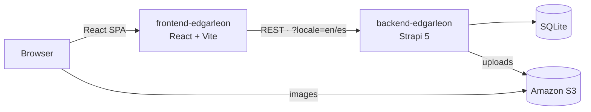
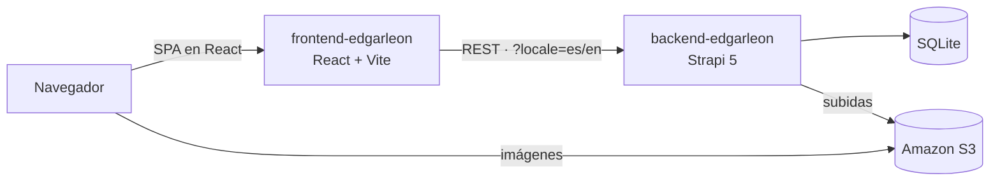

# Edgar León Archuleta — Portfolio


**[English](#english) · [Español](#español)**

---

## English

My personal portfolio: a bilingual (English / Spanish) single-page app with light and dark themes. None of the content is hard-coded — profile, projects and skills come from a headless CMS, so I can update the site without touching the code.

### Features

- **Bilingual content end to end.** UI strings and CMS content are available in `en` and `es`. If an entry isn't translated yet, the app falls back to English.
- **Headless CMS.** Strapi 5 serves the profile, projects (with Markdown case studies), skills and categories through a read-only public API.
- **Images on Amazon S3.** Uploads from the Strapi admin go straight to an S3 bucket; without AWS credentials it falls back to local storage.
- **Zero-setup content.** On first boot with an empty database, the backend grants public read access and seeds all the content automatically.
- **Light / dark theme** with no flash on load, and scroll-reveal animations.

### Architecture



### Tech stack

| Layer    | Technologies                                                         |
| -------- | -------------------------------------------------------------------- |
| Frontend | React 19, React Router 7, Vite 8, Tailwind CSS 4, react-markdown, Oxlint |
| Backend  | Strapi 5, TypeScript, SQLite, i18n, draft & publish                  |
| Storage  | Amazon S3 (`@strapi/provider-upload-aws-s3`)                         |

### Repository structure

```
.
├── backend-edgarleon/    Strapi 5 content API — see its README
└── frontend-edgarleon/   React SPA — see its README
```

### Running locally

Requirements: **Node.js 20+**.

```bash
# 1. Backend — http://localhost:1337 (admin at /admin)
cd backend-edgarleon
npm install
cp .env.example .env
npm run develop

# 2. Frontend — http://localhost:5173 (in a second terminal)
cd frontend-edgarleon
npm install
cp .env.example .env
npm run dev
```

The first time the backend starts, it loads all the portfolio content by itself. Strapi asks you to create an admin user the first time you open `/admin`.

To store images on S3, fill in the `AWS_*` variables in `backend-edgarleon/.env`. Details are in the [backend README](backend-edgarleon/README.md#imágenes-en-amazon-s3-opcional).

### Deployment

The live site is **static** and runs on Vercel: no Strapi server is online. `npm run snapshot` saves the content from my local Strapi into `frontend-edgarleon/src/data/content.json`, images are served from S3, and every push redeploys the site. In development, setting `VITE_STRAPI_URL` makes the frontend read Strapi live instead.

### More details

- [Backend README](backend-edgarleon/README.md): content model, endpoints, seed and S3.
- [Frontend README](frontend-edgarleon/README.md): scripts, environment variables, folder structure and design decisions.

### Contact

- GitHub: [@EdgarLeonArchuleta19](https://github.com/EdgarLeonArchuleta19)
- LinkedIn: [edgar-leon-archuleta](https://www.linkedin.com/in/edgar-leon-archuleta)
- Email: [leonedgar190@gmail.com](mailto:leonedgar190@gmail.com)

---

## Español

Mi portafolio personal: una SPA bilingüe (español / inglés) con tema claro y oscuro. Nada del contenido está escrito en el código: el perfil, los proyectos y las habilidades vienen de un CMS headless, así que puedo actualizar el sitio sin tocar código.

### Características

- **Contenido bilingüe de punta a punta.** Los textos de la interfaz y el contenido del CMS están en `es` y `en`. Si una entrada todavía no está traducida, se muestra en inglés.
- **CMS headless.** Strapi 5 expone el perfil, los proyectos (con casos de estudio en Markdown), las habilidades y sus categorías mediante una API pública de solo lectura.
- **Imágenes en Amazon S3.** Lo que se sube desde el admin de Strapi va directo a un bucket de S3; sin credenciales de AWS se guarda en local.
- **Contenido sin configuración.** Al arrancar por primera vez con la base vacía, el backend da permisos de lectura públicos y carga todo el contenido solo.
- **Tema claro / oscuro** sin parpadeo al cargar, y animaciones al hacer scroll.

### Arquitectura



### Stack

| Capa     | Tecnologías                                                          |
| -------- | -------------------------------------------------------------------- |
| Frontend | React 19, React Router 7, Vite 8, Tailwind CSS 4, react-markdown, Oxlint |
| Backend  | Strapi 5, TypeScript, SQLite, i18n, borrador y publicado             |
| Archivos | Amazon S3 (`@strapi/provider-upload-aws-s3`)                         |

### Estructura del repositorio

```
.
├── backend-edgarleon/    API de contenido con Strapi 5 — ver su README
└── frontend-edgarleon/   SPA en React — ver su README
```

### Correrlo en local

Requisitos: **Node.js 20+**.

```bash
# 1. Backend — http://localhost:1337 (admin en /admin)
cd backend-edgarleon
npm install
cp .env.example .env
npm run develop

# 2. Frontend — http://localhost:5173 (en otra terminal)
cd frontend-edgarleon
npm install
cp .env.example .env
npm run dev
```

La primera vez que arranca, el backend carga todo el contenido del portafolio solo. Strapi te pide crear un usuario administrador la primera vez que abres `/admin`.

Para guardar las imágenes en S3, llena las variables `AWS_*` en `backend-edgarleon/.env`. Los detalles están en el [README del backend](backend-edgarleon/README.md#imágenes-en-amazon-s3-opcional).

### Despliegue

El sitio en línea es **estático** y corre en Vercel: no hay ningún servidor de Strapi publicado. `npm run snapshot` guarda el contenido de mi Strapi local en `frontend-edgarleon/src/data/content.json`, las imágenes se sirven desde S3 y cada push vuelve a desplegar el sitio. En desarrollo, con `VITE_STRAPI_URL` el frontend lee Strapi en vivo.

### Más detalles

- [README del backend](backend-edgarleon/README.md): modelo de contenido, endpoints, seed y S3.
- [README del frontend](frontend-edgarleon/README.md): scripts, variables de entorno, estructura y decisiones de diseño.

### Contacto

- GitHub: [@EdgarLeonArchuleta19](https://github.com/EdgarLeonArchuleta19)
- LinkedIn: [edgar-leon-archuleta](https://www.linkedin.com/in/edgar-leon-archuleta)
- Correo: [leonedgar190@gmail.com](mailto:leonedgar190@gmail.com)
